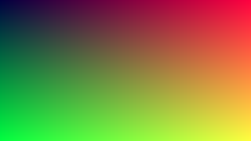

# software-rasterizer

A 3D software rasterizer written from scratch in C++20: from vertices to pixels, with no graphics
library and no GPU. Every stage of the pipeline is written by hand and checked by tests. The output
is an image file, so every result can be compared with a reference automatically.

The project is built in stages, starting from the end of the pipeline so that each stage produces
an image.

## Status

| Stage | Topic | Result | State |
|---|---|---|---|
| 1 | Framebuffer, PPM output | Gradient image | Done |
| 2 | Rasterization | Filled triangle | Planned |
| 3 | Interpolation | RGB triangle | Planned |
| 4 | Transformations | Matrices and their order | Planned |
| 5 | Projection | Perspective wireframe cube | Planned |
| 6 | Z-buffer | Depth test, OBJ meshes | Planned |
| 7 | Perspective-correct interpolation | Checkerboard floor | Planned |
| 8 | Lighting | Flat, Gouraud and Phong shading | Planned |
| 9 | Clipping | Triangles crossing the near plane | Planned |
| 10 | Measurements | Timings and profile | Planned |

## Stage 1: a grid of numbers becomes a file



A 320x180 image where red grows with x, green grows with y and blue is constant at 0.25. Each pixel
is sampled at the center of its cell, `((x + 0.5) / W, (y + 0.5) / H)`.

What exists so far:

- `Framebuffer`: a row-major grid of float RGB pixels, with bounds checked by `assert`.
- `to_byte`: float in [0, 1] to byte in [0, 255], with saturation and rounding to nearest.
- `write_ppm`: binary PPM (P6) output to any `std::ostream`.
- Tests for all of the above, including a comparison with a reference image.

## Build

Requires a C++20 compiler (developed with GCC), CMake 3.25 or newer and Ninja. GoogleTest is used
from the system if installed, otherwise version 1.17.0 is downloaded.

```sh
cmake -S . -B build/debug -G Ninja -DCMAKE_BUILD_TYPE=Debug
cmake --build build/debug
ctest --test-dir build/debug --output-on-failure

mkdir -p out
./build/debug/render t1_gradient out/t1_gradient.ppm
```

The Debug build enables AddressSanitizer and UndefinedBehaviorSanitizer, plus
`-fsanitize=float-cast-overflow`, which GCC does not include in `-fsanitize=undefined`. Pass
`-DRASTER_SANITIZE=OFF` to turn them off. Warnings are strict (`-Wall -Wextra -Wpedantic
-Wconversion -Wsign-conversion -Wdouble-promotion -Wshadow`) and treated as errors in this
project's code only.

PPM files are not shown by GitHub. Convert one to PNG with ImageMagick:
`magick out/t1_gradient.ppm docs/images/t1_gradient.png`.

## Technical choices

- **PPM files, no window.** No dependencies, deterministic output, automatic comparison with
  reference images. The cost is no real-time interaction.
- **Math written by hand, no GLM.** Writing every step is the point of the project. The cost is more
  code to write and to test.
- **Float framebuffer.** Values outside [0, 1] survive until the image is saved, and the encoding
  can still change at the end of the render. The cost is four times the memory of 8-bit channels.
- **Signed `int` coordinates.** Coordinates are subtracted and can leave the screen before
  clipping, and unsigned types would wrap silently.
- **OpenGL conventions** (right-handed, column vectors, NDC z in [-1, 1]) from stage 4 on, so the
  same math carries over to OpenGL code.
- **Built from the end of the pipeline.** Each stage produces an image from the first day. The
  cost is that the full 3D pipeline only appears at stage 6.

## What it does not do

- It does not open a window or run in real time.
- It does not build with MSVC: it is developed and tested with GCC on Linux only.
- It does not implement anything beyond the stages marked Done above.
